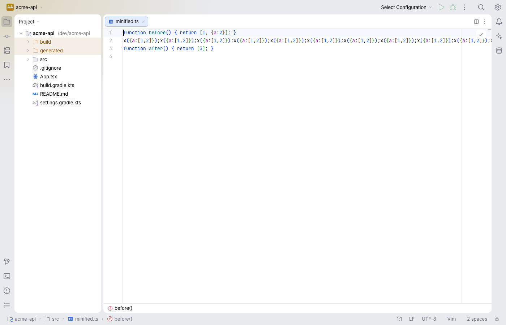
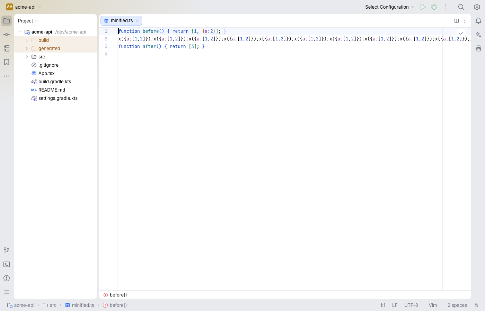

# Rainbow bracket minified-line evidence

17 November 2026. Before: `7a351fe4b088102212d9e066c43e5c35c5764229`; after: `920826b`.
macOS, headless Chromium (exact browser version is in every raw report), 1400×900 viewport.
The workbench is a production `--mode perf` bundle. Native Tauri/WebKit was not verified.

## Method

Built separate before/after bundles with the same external Vite hook (`perf.vite.ts`).
The hook enables/disables Rainbow brackets through project settings; the harness asserts activation.
No source instrumentation is part of the proposed fix.

Two alternating main/fix rounds: one warmup + five measured runs per scenario and mode in each round.
Scenarios: 20k-line typing and scrolling, plus typing/horizontal scrolling in 208,000- and
1,040,000-character lines. Both `off` and `brackets` modes were measured. See `summary.md` and
`result-{main,fix}-{1,2}.json`. Summary values are medians of each run's metrics, including its p95;
they are not percentiles pooled over every individual keystroke.

Four additional alternating main/fix pairs measured only `scroll` in `brackets` mode, with one
warmup + five measured runs per version in each pair (20 samples per version). No build/test/native
launch ran alongside these additional measurements. See `scroll-summary.md` and the raw scroll JSONs.
Fling median p95: 16.8 ms for both; median dropped frames: 4.42% before, 4.14% after.
The third pair had fling p95 about 33.3 ms on both versions. No regression was detected in this workload.

Example reproduction (Node with TypeScript support and project dependencies):

```sh
PERF_ROOT=/absolute/path/to/openidea pnpm exec vite build --mode perf --config /absolute/path/to/evidence/perf.vite.ts --outDir /absolute/path/to/bundle
PERF_ROOT=/absolute/path/to/openidea PERF_MODES=brackets PERF_ONLY=scroll PERF_WARMUP=1 PERF_RUNS=5 node /absolute/path/to/evidence/perf.ts /absolute/path/to/bundle label /absolute/path/to/result.json
```

Use the same harness and browser, build the before/after revisions separately, and alternate them.
`perf.ts` imports the repository's `perf/lib` and `perf/scenarios.ts` from `PERF_ROOT`.
`bundles.txt` preserves the original bundle fingerprints; generated bundles themselves are not retained.
The only change after those bundles were measured was formatting in a test file.

## Checks

- `pnpm typecheck`, `pnpm lint`, `pnpm format:check`, `pnpm knip`: passed. Lint has nine warnings in untouched files; knip has an ignore hint.
- `pnpm test --maxWorkers=4`: 1014 files passed; 12,933 tests passed, 6 skipped.
- `pnpm build`: passed, including Safari 15.4 startup API and bundle syntax checks.
- `pnpm e2e e2e/editor.spec.ts e2e/codeInsight.spec.ts --workers=2`: 27 passed. Full E2E suite was not run.

## Screenshots

Same fixture and 1400×900 viewport. A 208,000-character line is between two short lines.
`checks.json` verifies the full document length and rendered rainbow marks: 8 → 8 on the first
short line, 983 → 0 on the long line, 6 → 6 on the last short line. CodeMirror renders only part
of the long line in the DOM. Syntax highlighting remains enabled.

| Before | After |
|---|---|
|  |  |

## Review decision

Lines of at least **10,000 UTF-16 code units** lose rainbow colouring, and their brackets are
excluded from nesting-depth calculations. This matches the existing indent-guide cutoff but
extends it to the shared bracket scanner. Maintainer approval of this fallback is requested.
